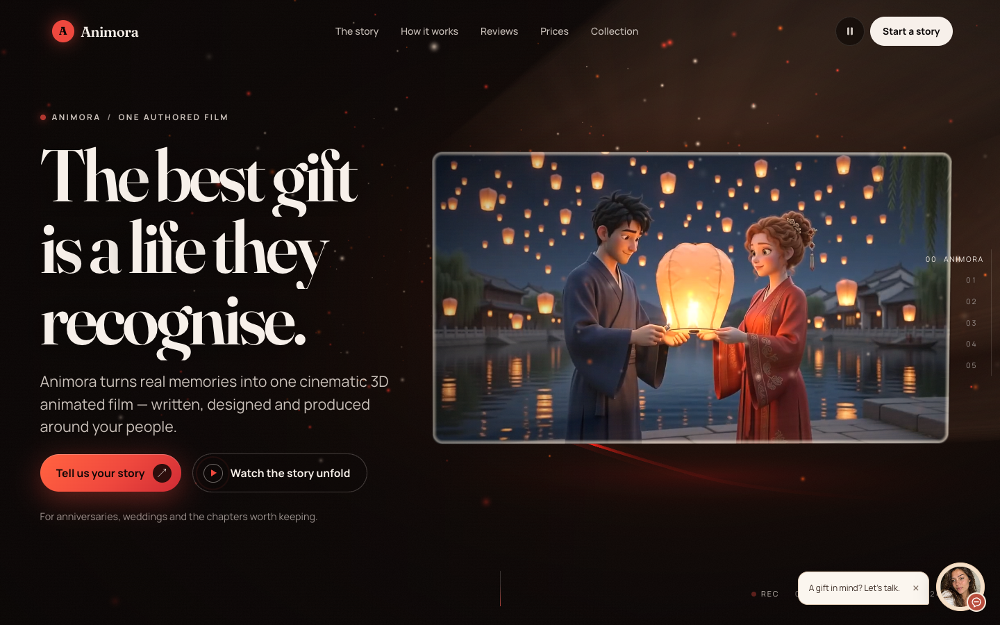
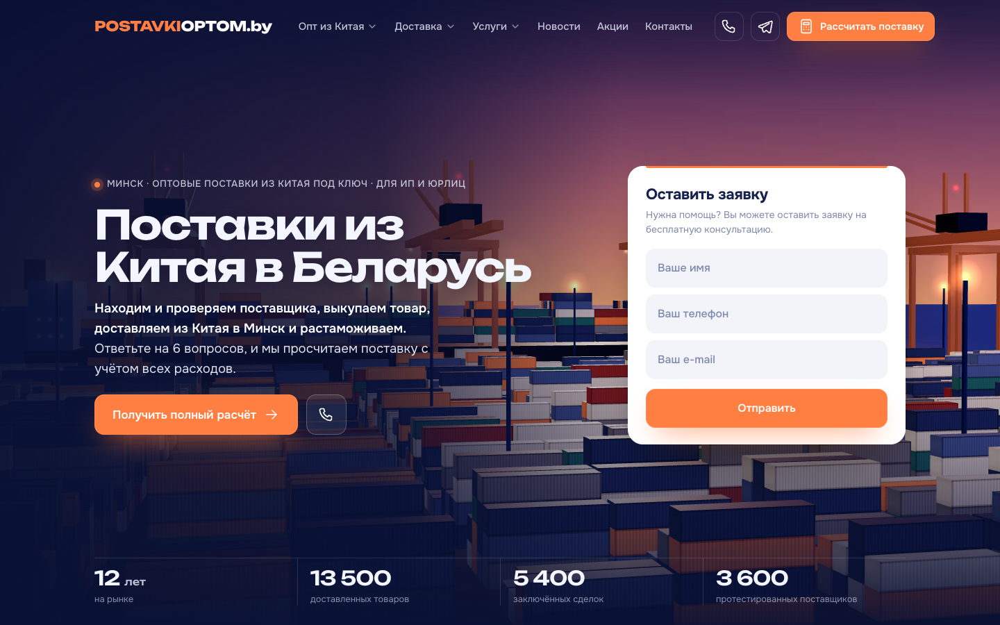
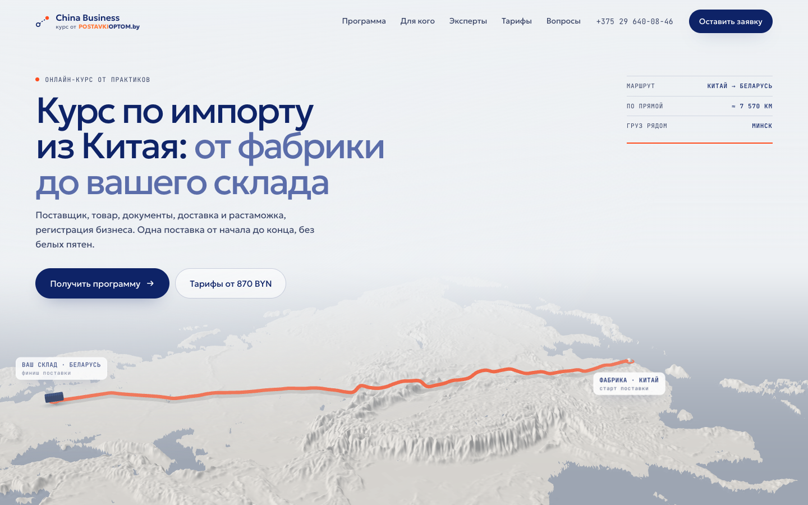
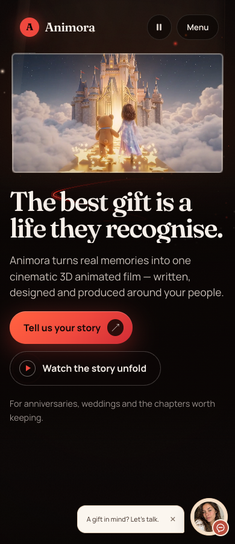
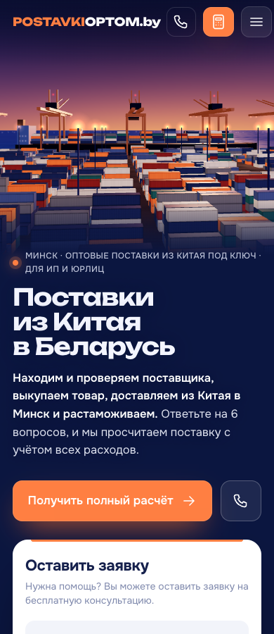

# CinematicSite

### Build a world around your brand.

An AI coding skill for turning a brand brief into a distinctive website—with art direction, 3D and motion, and careful desktop/mobile checks.

[](https://github.com/icryptan/cinematic-site-skill/actions/workflows/check.yml)
[](LICENSE)
[](https://github.com/icryptan/cinematic-site-skill/stargazers)

[Selected work](#selected-work) · [Quick start](#quick-start) · [Example briefs](#example-briefs) · [Inside the skill](#inside-the-skill)

[](https://animora.video/stories/)

*Featured: [Animora](https://animora.video/stories/) — cinematic storytelling, warm light, expressive typography, and a film at the heart of the experience.*

**Find this useful? [Give the repository a star](https://github.com/icryptan/cinematic-site-skill/stargazers) to save it and help others discover the skill.**

---

## What changes when you use it

- **A direction before a design.** Real references lead to two or three distinct options; you choose the one that fits the brand.
- **Motion with a purpose.** A persistent Three.js world, video, DOM-based motion, or a lighter editorial layout—chosen for the story.
- **A complete first screen.** The headline, subject, and main action work together on desktop and mobile.
- **Evidence before handover.** Build checks, browser review, reduced-motion behavior, and loading fallbacks are part of the workflow.

The starter stays neutral. Each project's layout, typography, sections, scenes, and motion come from its own brief.

## Quick start

**1. Get the skill.** You need Bun and Git.

```bash
git clone https://github.com/icryptan/cinematic-site-skill.git
cd cinematic-site-skill
```

**2. Add it to your agent.** Copy the entire `CinematicSite/` folder into your coding agent's skills directory. Keep its subfolders together. See the [setup guide](CinematicSite/Setup.md) for dependencies and configuration.

**3. Give it a brief.** Start with the audience, the feeling, and the action you want visitors to take:

```text
Use CinematicSite to create a premium website for a ceramics studio.
It should feel calm, tactile, and full of daylight.
The main action is booking a studio visit.
Show 2–3 distinct art directions with references, then wait for my choice.
The finished site must work on desktop and mobile, including reduced motion.
```

<details>
<summary>Run the neutral Astro starter directly</summary>

From the repository root, choose a destination directory that does not already exist:

```bash
bun CinematicSite/Tools/NewSite.ts --name demo-site --brand "Demo Studio" --dir /tmp/demo-site --no-git
cd /tmp/demo-site
bun run build
bun run verify
bun run preview
```

The generator installs dependencies by default. Add `--no-install` to generate source files only. Existing directories are never overwritten. The `preview` command prints an available port; press Ctrl+C to stop it.

The generated site starts with neutral placeholders. The `bun run verify -- --release` check intentionally rejects it until the placeholders are replaced and all translations are complete. Choose Three.js and other assets separately when the project's direction calls for them.

</details>

## Selected work

Three public websites from the author's work, showing different ways to combine a brand, a story, and a visual world. These are live examples, not bundled templates; their full source code, scenes, branding, and business integrations are not included in this repository.

### 01 / Animora

**Personal stories, presented as cinema.** Warm highlights, large editorial type, and an animated film give a gift a sense of occasion. The featured desktop capture is at the top of this README.

[Visit the live website](https://animora.video/stories/) · [Desktop capture](docs/images/animora-desktop.png) · [Mobile capture](docs/images/animora-mobile.png)

### 02 / Postavki Optom

**A shipment's journey becomes the visual world.** A port scene gives a logistics business a memorable setting, while the service and quote request remain easy to understand.

[](https://postavkioptom.by/)

[Visit the live website](https://postavkioptom.by/) · [Mobile capture](docs/images/postavki-mobile.png)

### 03 / China Business

**The same industry, a different tone.** A bright landscape and a route across the map turn an import course into a clear journey from factory to warehouse.

[](https://postavkioptom.of.by/)

[Visit the live website](https://postavkioptom.of.by/)

<details>
<summary>See the mobile layouts</summary>

#### Animora · 390 px



#### Postavki Optom · 390 px



</details>

Screenshots were captured from the public pages on October 31, 2026. Website content and brand rights remain with their respective owners. [Image sources and usage](docs/images/README.md).

## Example briefs

### A product with its own 3D world

```text
Use CinematicSite for a boutique telescope brand.
The website should feel like stepping into a quiet observatory at night.
A single 3D world should connect the product, its details, and the sky.
The main action is requesting a demonstration.
Present distinct directions before building, and give the chosen design
a useful mobile and reduced-motion experience.
```

### A careful redesign

```text
Use CinematicSite to redesign the website at [website URL].
Keep the real content and primary inquiry flow accurate.
The new design should make the service clearer and give the brand
a distinctive visual identity grounded in references.
Show the design directions for approval before implementation.
Deliver a working preview with desktop and mobile evidence.
```

## How the skill works

1. The brief defines the audience, the intended visitor action, and the available materials.
2. Visual references inform the principles; the agent presents two or three distinct design directions.
3. Once a direction is chosen, the agent builds the sections and visuals: a 3D world, video, DOM-based motion, or a hybrid.
4. The build, fallbacks, and rendered views are checked on desktop and mobile.
5. The owner receives a verified preview. Public deployment requires separate approval and a backup.

## Inside the skill

The `CinematicSite/` folder contains:

| Part | Purpose |
|------|---------|
| `SKILL.md` | Entry point and task routing |
| `Intents/` | Create a site, verify it, and deploy with approval |
| `References/` | Art direction, techniques, quality, sources, and technical pitfalls |
| `Tools/` | Project generator, optional Chrome diagnostics, and usage guides |
| `Kit/` | Neutral Astro starter, localization, tokens, fallbacks, preview server, and build checks |

<details>
<summary>Tool checks and browser diagnostics</summary>

```bash
bun test ./CinematicSite/Tools
bun CinematicSite/Tools/NewSite.ts --help
bun CinematicSite/Tools/Check.ts --help
```

Generator tests verify the tooling, not the quality of a finished design. The automated `Check.ts` provides additional diagnostics; visual review in a real browser is still required. See its [usage guide and limitations](CinematicSite/Tools/Check.help.md).

</details>

<details>
<summary>Network access and secrets</summary>

The generator does not require API keys. `bun install` contacts the package registry. `Check.ts` loads the target website and its resources in Chrome. The preview server listens on all interfaces; noindex is not access control. The owner configures external hosting and access restrictions. The tools in this repository do not call AI models or send analytics themselves.

</details>

## References and license

Optional public sources are listed in the [reference guide](CinematicSite/References/References.md); their code and assets are not bundled. Astro and other dependencies retain their own licenses. Original materials in this repository are available under the [MIT License](LICENSE).

---

### Make your next website worth remembering.

If CinematicSite helps you build something you're proud of, **[star this repository](https://github.com/icryptan/cinematic-site-skill/stargazers)**. It is a small way to support the project and keep it in your toolkit.
